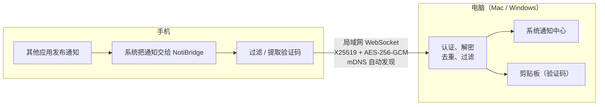

# NotiBridge

把**手机**上的通知同步到**电脑**，在电脑的系统通知中心显示；验证码自动复制到电脑剪贴板。一台手机可以同时连接多台电脑，一台电脑也可以配对多台手机。全部在局域网内端到端加密传输，不经过任何服务器。

| 端 | 技术 | 系统要求 |
|---|---|---|
| 手机 · 安卓 | Kotlin + Jetpack Compose，`android/` | Android 8.0+ |
| 手机 · 鸿蒙 | ArkTS + ArkUI（Stage 模型），`harmony/` | HarmonyOS API 22+（推荐 API 26），需自行签名 |
| 电脑 · Mac | Swift + SwiftUI 菜单栏应用，`mac/` | macOS 14+ |
| 电脑 · Windows | C# / .NET 10 + WPF 托盘应用，`windows/`（见 [windows/README.md](windows/README.md)） | Windows 10 1809+ / 11 |

## 功能

- **通知镜像**：微信、QQ、短信、邮件等通知实时出现在电脑通知中心；手机上撤销后，电脑上同步移除。通知会显示原应用图标：电脑上装了对应应用的用它的图标，否则显示彩色首字母
- **验证码同步**：识别验证码短信后只发送验证码数字（不发全文），电脑自动复制到剪贴板，2 分钟后清除。按应用屏蔽的应用不发；开启敏感过滤时，银行/支付类验证码默认也不发（手机上可以单独允许）
- **过滤**：默认不转发银行、支付类通知；手机端和电脑端都可以按应用屏蔽，电脑端支持白名单/黑名单
- **去重与暂停**：同一条通知不重复弹出；两端都可以一键暂停同步
- **后台可靠**：手机端通知由系统交给 NotiBridge 后立即转发，切到后台、熄屏后依然有效，不做常驻连接
- **安全配对**：6 位配对码 + CPace（PAKE），录下配对过程也无法离线猜出配对码；两端再核对 8 位校验码。之后每次连接双向认证，所有消息 AES-256-GCM 加密，两个方向都防重放
- **iPhone（经 ESP32）**：iPhone 不能装第三方后台通知转发，可以用一块 ESP32 模块插在电脑 USB 上：iPhone 通过蓝牙（Apple 官方 ANCS）把通知交给 ESP32，再转到电脑，验证码同样自动复制。电脑端 App 内置一键刷写固件，不需要另装工具
- **多设备**：手机可配对多台电脑（Mac、Windows 混用），通知同时转发到每一台；电脑可配对多台手机，通知会标出来自哪台手机，也可以在电脑上给每台手机改名；同步开关在所有设备间双向同步

## 工作原理



手机读取通知用的是各系统的官方接口：安卓是通知使用权（`NotificationListenerService`），鸿蒙是通知订阅扩展能力。协议见 [docs/protocol.md](docs/protocol.md)。

## 安装

### Mac 端

1. 在 [Releases](../../releases) 下载 `NotiBridge-<版本>-macOS.dmg`，把 NotiBridge 拖到“应用程序”。
2. 安装包没有经过 Apple 公证。第一次打开时，在“应用程序”里**右键 NotiBridge →“打开”**，或者在“系统设置 > 隐私与安全性”中点“仍要打开”。
3. 首次启动会进入引导，按提示授予权限并生成配对码。

### Windows 端

1. 在 [Releases](../../releases) 下载 `NotiBridge-<版本>-Windows-x64.exe`（单文件，无需安装），也可以按 [windows/README.md](windows/README.md) 自己编译。
2. 程序未做代码签名，SmartScreen 提示时点“更多信息 → 仍要运行”；防火墙弹窗时允许“专用网络”。
3. 首次启动会进入引导；之后程序常驻任务栏托盘。

### 安卓端

1. 在 [Releases](../../releases) 下载 `NotiBridge-<版本>-Android.apk`，在手机上打开安装（需要允许浏览器或文件管理器“安装未知应用”）。
2. 首次打开会进入引导：开启“通知使用权”→ 允许不受电池优化限制 → 与电脑配对。安卓端**不需要**蓝牙配对。
3. 如果系统提示“受限设置”无法开启通知使用权：到 设置 › 应用 › NotiBridge，右上角菜单选“允许受限设置”后再开启。
4. 小米、华为、OPPO、vivo 等手机建议在系统的“自启动 / 后台运行”管理里允许 NotiBridge。

### iPhone（ESP32 模块）

1. 准备一块 ESP32 开发板（经典 ESP32，例如 ESP32-WROOM-32E；不支持 S2/S3/C3），用支持数据传输的 USB 线插到电脑。CH340 芯片的板子在 Mac 上要先装[沁恒 CH34x 驱动](https://www.wch.cn/downloads/CH34XSER_MAC_ZIP.html)。
2. 电脑端 设置 › 使用方式 选“使用 ESP32”，点“检测已连接的 ESP32”→“刷写固件”（约 30 秒）。
3. 在 iPhone「设置 › 蓝牙」里点 NotiBridge 配对，并在弹窗里允许“显示通知”。之后 iPhone 会自动重连。

串口协议与固件说明见 [docs/esp32-serial.md](docs/esp32-serial.md)，固件源码在 [firmware/esp32](firmware/esp32)。

### 鸿蒙端

鸿蒙读取第三方通知的唯一官方方式是“通知订阅扩展能力”（`notificationExtensionSubscription` + `NotificationSubscriberExtensionAbility`）。它有两个硬性前提：

1. 受限权限 `ohos.permission.SUBSCRIBE_NOTIFICATION`
2. 一台**已配对**的蓝牙设备（系统设计给“手表配套应用”使用）

详见 [docs/feasibility.md](docs/feasibility.md)。

#### 鸿蒙端需要自己签名

`SUBSCRIBE_NOTIFICATION` 是受限权限，只有两种获得方式：

| 方式 | 说明 |
|---|---|
| **DevEco Studio 自动签名（调试）** | 用自己的华为开发者账号自动签名，生成的调试 Profile 会包含该权限。**只对你登记的手机有效，每 14 天到期**，到期后重新签名安装即可（约 1 分钟，见 [docs/renew-signing.md](docs/renew-signing.md)） |
| AppGallery Connect 正式申请 | 需人工审核，官方场景是智能手表配套应用，本项目这类用途大概率无法通过 |

因此 Release 里的鸿蒙安装包是**未签名**的，不能直接安装；推荐直接用 DevEco Studio 打开源码运行。

需要：DevEco Studio 6.0.2 或更高版本、华为开发者账号、HarmonyOS API 22 或更高版本的手机（推荐 API 26）。

1. 手机开启开发者模式和 USB 调试，连接电脑。
2. 用 DevEco Studio 打开本仓库里的 `harmony` 文件夹（不是仓库根目录），等待同步完成。
3. **File > Project Structure > Project > Signing Configs**，勾选 **Automatically generate signature**，登录华为账号。签名完成后，把鼠标悬停在 Profile 上，确认 ACL 中包含 `ohos.permission.SUBSCRIBE_NOTIFICATION`。
4. 点 Run 安装到手机，或者在终端运行 `harmony/scripts/install_phone.sh`。

> 也可以用自己的证书，给 Release 中的 `*-HarmonyOS-unsigned.hap` 签名后再安装，但同样需要包含上述 ACL 的 Profile。

## 首次使用

手机和电脑第一次打开都会进入引导：

1. **电脑**：授予权限 → 点“配对新手机”，显示 6 位配对码。
2. **手机**：允许读取通知 → 在“连接电脑”里选择局域网中找到的电脑（找不到可以手动输入 IP）→ 输入电脑上的配对码，并核对两端校验码一致。

手机和电脑需要连着同一个局域网。鸿蒙手机还要多一步：绑定一台已配对的蓝牙设备（可以就是这台电脑），引导里会提示。

## 权限说明

### 安卓端

| 权限 | 是否必需 | 用途 |
|---|---|---|
| 通知使用权 | 必需 | 读取通知并加密转发到配对的电脑；可在“按应用屏蔽”里排除应用 |
| 不受电池优化限制 | 推荐 | 防止系统在后台停止通知监听 |
| 网络 / 本地网络 | 自动 | 局域网发现电脑并发送加密通知，不经过任何服务器 |
| 安装应用 | 更新时 | 下载新版后由你确认安装 |

### 鸿蒙端

| 权限 | 类型 | 用途 |
|---|---|---|
| `ohos.permission.SUBSCRIBE_NOTIFICATION` | 受限，随签名授予 | 读取你在系统授权页中选择的应用的通知 |
| 系统授权页“允许获取本机通知” | 用户授权 | 由你逐个选择允许读取哪些应用 |
| `ohos.permission.ACCESS_BLUETOOTH` | 用户授权 | 读取已配对设备列表、扫描并配对，用于选择订阅所需的蓝牙设备 |
| `ohos.permission.INTERNET` | 系统授权 | 通过局域网连接自己的 Mac |

### Mac 端

| 权限 | 必要性 | 用途 |
|---|---|---|
| 通知 | 必需 | 显示手机通知和“验证码已复制”提示 |
| 本地网络 | 必需 | 被同一 Wi-Fi 下的手机发现，接收加密通知 |
| 蓝牙 | 按需 | 仅鸿蒙手机需要：让 Mac 作为鸿蒙通知订阅所需的蓝牙配对设备 |
| 登录时启动 | 推荐 | 开机后自动在菜单栏运行 |
| 麦克风 | 可选 | 仅用于实验性通话功能 |

## 自动更新

所有端共用同一个版本号，安装包都发布在 [GitHub Releases](https://github.com/Allen-1002/NotiBridge/releases)。

| 端 | 行为 |
|---|---|
| Mac | 启动 30 秒后检查一次，之后每 6 小时检查一次。发现新版本后自动下载 dmg，先用内置公钥验证 `SHA256SUMS.txt.sig`（发布者的 Ed25519 签名），再核对 `SHA256SUMS.txt`、`codesign` 签名、包名和版本号，然后退出、替换 `/Applications/NotiBridge.app` 并重新打开，通知“已更新到 x.y.z” |
| Windows | 同样的检查频率。下载 zip，验证 `SHA256SUMS.txt.sig` 签名，核对 SHA256 和 exe 文件版本后，由新版 exe 等旧进程退出再覆盖原位置（安装版会同时更新“已安装的应用”里的版本号；免安装版直接覆盖原 exe），重新启动后弹出通知 |
| 安卓 | 设置 > 软件更新 检查新版本，点“下载并安装”后下载 APK，验证 `SHA256SUMS.txt.sig` 签名，核对 `SHA256SUMS.txt` 和签名证书（必须与已安装的一致），再交给系统安装器由你确认安装 |
| 鸿蒙 | 只提醒：设置 > 软件更新 显示最新版本，“查看新版本”在浏览器打开发布页。鸿蒙应用不能自己安装 hap，而且需要用你自己的调试签名，请用 DevEco Studio 重新签名安装 |

- 在 设置 > 软件更新 中可以关闭“自动检查更新”或“自动下载并安装”（关闭后有新版本时只提示，点“立即更新”再安装），也可以手动“检查更新”
- 发布签名缺失或不对、校验值不一致、签名或版本号不对时放弃更新并删除下载的文件；正在配对手机时不更新
- 更新说明的第一行会在下载前显示（例如 1.1.0 的“安全更新，需要重新配对”）。Windows 安装包没有 Authenticode 代码签名证书，完整性由上面的 Ed25519 发布签名保证
- 检查更新只访问 GitHub（`api.github.com` 和发布文件下载地址），不发送任何个人数据
- Mac 端如果 NotiBridge.app 所在位置没有写权限（例如不在“应用程序”文件夹里），会打开下载好的 dmg 请你手动拖入

## 卸载与清除数据

| 端 | 位置 | 清除/卸载时删除的数据 |
|---|---|---|
| Mac | 设置 > 卸载与重置 | 配对文件 pairing.dat（以及旧版本残留在钥匙串里的配对密钥）、本机设备标识和全部设置（UserDefaults）、图标缓存、登录时启动项、已显示的通知。“卸载”会再把 NotiBridge.app 移到废纸篓 |
| Windows | 设置 > 关于 | `%APPDATA%\NotiBridge`（设置、DPAPI 加密的配对密钥）、`%LOCALAPPDATA%\NotiBridge`、开机启动项、通知；“卸载”还会移除快捷方式、通知注册和“已安装的应用”条目，详见 [windows/README.md](windows/README.md#卸载) |
| 安卓 | 设置 > 其他 > 清除所有数据 | 所有电脑的配对密钥（含 Keystore 主密钥）、设备 ID、同步与过滤设置、本机通知记录。卸载 App 时这些也会一起删除 |
| 鸿蒙 | 设置 > 其他 > 清除所有数据 | 通知订阅、所有电脑的配对密钥（Asset Store）、设备 ID、同步与过滤设置、本机通知记录。应用不能卸载自己：清除后在桌面长按 NotiBridge 图标选择卸载 |

清除后两端都需要重新配对。系统层面的权限记录（macOS 通知/蓝牙授权、鸿蒙“允许获取本机通知”授权、蓝牙配对）由系统管理，需要时请在系统设置中移除。

## 隐私与安全

- 通知只在你的手机和你的电脑之间通过局域网传输，没有服务器，没有统计或上报；唯一的外网访问是向 GitHub 检查更新（可关闭）
- 配对（协议 v2，1.1.0 起）：CPace（draft-irtf-cfrg-cpace，X25519 + SHA-512）。配对码只用来生成 PAKE 的生成元，录下整段配对流量也无法离线验证任何一个配对码猜测；主动攻击每次配对只能猜一次，电脑端 3 次失败后作废配对码，配对码 2 分钟过期。双方在保存密钥前互相验证确认码，两端再显示 8 位校验码（1234 5678）供人工比对，多一道防中间人的保险
- 每次连接双向挑战应答，未配对或密钥不对的设备直接断开；业务消息 AES-256-GCM 加密，两个方向用不同的 AAD，手机→电脑带递增 `seq`、电脑→手机带递增 `cseq`，重放和乱序的消息都会被拒绝
- 电脑端限制同时连接数（16）、单 IP 新连接速率（每分钟 10 次）、认证超时（10 秒，配对时 90 秒）和认证前帧大小（16 KB），同一 IP 连续失败后指数退避封禁
- 取消配对只通过加密认证的消息生效；电脑回“不认识这台手机”时手机只提示，不会自动删除（这个回复可能是伪造的）
- 密钥存放：Windows 为 DPAPI 加密文件，鸿蒙为系统 Asset Store，安卓为 Android Keystore 包装的私有文件。**Mac** 为 `~/Library/Application Support/com.xsh.notibridge.desktop/pairing.dat`：AES-GCM 加密，文件密钥由这台 Mac 的硬件 UUID 和电脑 ID 派生，所以复制到别的电脑上无法解密；但**同一用户账户下运行的其他程序理论上可以算出密钥并解密**。这是有意的取舍：App 没有 Apple 开发者 ID 签名，用钥匙串的话每次更新后都会为每台手机重新弹出授权
- 手机上的通知记录只保存应用、时间、处理结果和发往的电脑，不保存标题和正文；敏感内容不记录；最多 200 条 / 256 KB、保留 7 天，可以在设置里关闭或清空
- 两端日志都不记录通知标题和正文
- 自动更新只安装带发布者 Ed25519 签名的版本（私钥只在发布者电脑上）

协议细节见 [docs/protocol.md](docs/protocol.md)，四端共用的测试向量见 [docs/test-vectors/](docs/test-vectors/)。

> **从 1.0.x 升级到 1.1.0**：配对协议换成了 v2，与旧版不兼容。升级后四端都会清除旧配对，电脑和手机都要更新到 1.1.0 后**重新配对一次**。

## 从源码构建

```bash
# Mac 端：构建 .app（ad-hoc 签名）并安装到 /Applications
cd mac
./build_app.sh release install

# Mac 端：协议单元测试
swift test

# 鸿蒙端：CPace / 过滤逻辑的单元测试（在电脑上用 Node 运行，对照 docs/test-vectors）
node harmony/scripts/test_cpace.mjs

# 重新生成共享测试向量（需要 pip 包 cryptography）
python3 docs/test-vectors/generate_pairing_v2.py

# Windows 端：在 Mac 上交叉编译单文件 exe（需要 .NET 10 SDK），产物 windows/dist/NotiBridge.exe
cd windows && ./build.sh

# 安卓端：需要 JDK 17+ 和 Android SDK（compileSdk 37），产物 android/app/build/outputs/apk/
cd android && ./gradlew testDebugUnitTest assembleRelease
# 发布签名：android/keystore.properties（不提交）指向仓库外的签名文件；没有它时 release 包不签名

# 鸿蒙端：命令行构建（需要 DevEco Studio）
cd harmony
export DEVECO_SDK_HOME=/Applications/DevEco-Studio.app/Contents/sdk
export PATH=/Applications/DevEco-Studio.app/Contents/tools/node/bin:$PATH
/Applications/DevEco-Studio.app/Contents/tools/hvigor/bin/hvigorw assembleHap --mode module -p product=default -p buildMode=debug
```

## 目录结构

```
harmony/            # 鸿蒙工程（DevEco Studio 打开这个文件夹）
├── AppScope/ entry/ hvigor/ build-profile.json5 …
├── scripts/install_phone.sh   # 构建签名 HAP 并安装到手机
└── entry/src/main/ets/
    ├── extensionability/NotificationSubscriberExtAbility.ets  # 系统拉起的通知订阅扩展
    ├── common/       # 订阅、蓝牙、加密、配对存储、过滤、转发
    ├── components/   # 通用 UI 组件、蓝牙面板、电脑配对面板（多台）
    └── pages/        # 引导、首页（首页/通知/设置）、蓝牙、电脑连接、应用屏蔽、调试
android/app/src/main/java/com/xsh/notibridge/
├── core/         # 协议、加密（X25519/HKDF/AES-GCM）、电脑链路、转发、过滤、更新逻辑（纯 JVM，可单元测试）
├── data/         # 配对存储（Keystore 加密）、局域网发现、通知记录
├── service/      # 通知监听服务、自动更新
└── ui/           # 引导、首页/通知/设置、电脑连接、应用屏蔽、调试
mac/
├── Sources/NotiBridgeCore/   # 协议、加密、会话状态机、过滤与去重（可单元测试）
├── Sources/NotiBridgeMac/    # 菜单栏应用、WebSocket 服务、通知、首次引导
└── Tests/
windows/
├── src/NotiBridge.Core/      # 与 Mac 端对应的协议核心（跨平台，可在 Mac 上测试）
├── src/NotiBridge.Windows/   # WPF 托盘应用、Toast 通知、DPAPI、DNS-SD
└── tests/
docs/             # 可行性调研、协议、续签说明
```

## 已知限制

- 鸿蒙端依赖调试签名，每 14 天需要重新签名一次
- 鸿蒙端必须有一台已配对的蓝牙设备（系统规定；安卓端不需要）
- 安卓端的通知监听可能被部分厂商系统的后台管理停止，需要允许自启动/后台运行
- Mac 端未经 Apple 公证、Windows 端未做 Authenticode 代码签名，首次打开需要手动放行（自动更新的完整性由 Ed25519 发布签名保证）
- Mac 端配对文件只绑定本机硬件，不能防止同一用户账户下的其他程序读取（见“隐私与安全”）
- 手机和电脑需要在同一局域网内；Windows 上当前网络需为“专用网络”

## 计划

- 通话桥接：ESP32（经典蓝牙 HFP + USB 串口）让电脑接听手机来电，音频经 USB 传输、回声消除在电脑上完成。实测表明 macOS 自身无法作为 HFP 免提设备连接鸿蒙手机。

## 许可证

[MIT](LICENSE) © 2026 Shenghao Xu
