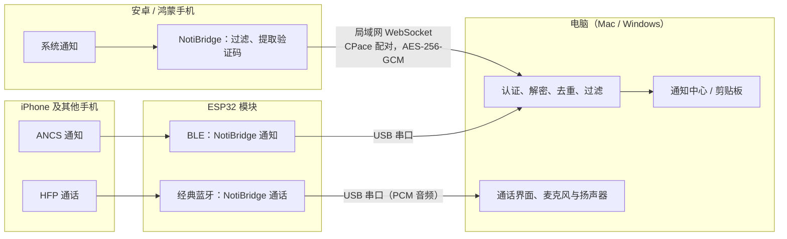

# NotiBridge

NotiBridge 把手机通知同步到电脑的系统通知中心，并把短信验证码复制到电脑剪贴板。配合一块 ESP32 模块，还支持 iPhone 通知同步和在电脑上接打电话。

数据只在局域网内（或经 USB 连接的 ESP32）传输，端到端加密，不经过任何服务器。

| 组件 | 技术 | 目录 | 系统要求 |
|---|---|---|---|
| 安卓客户端 | Kotlin，Jetpack Compose | `android/` | Android 8.0 及以上 |
| 鸿蒙客户端 | ArkTS，ArkUI（Stage 模型） | `harmony/` | HarmonyOS API 22 及以上（推荐 API 26），需自行签名 |
| Mac 客户端 | Swift，SwiftUI 菜单栏应用 | `mac/` | macOS 14 及以上 |
| Windows 客户端 | C#，.NET 10，WPF 托盘应用 | `windows/` | Windows 10 1809 及以上，x64 |
| ESP32 固件 | C，ESP-IDF 5.4（Bluedroid 双模） | `firmware/esp32/` | 经典 ESP32（如 ESP32-WROOM-32E），4 MB 闪存 |

## 功能

- 通知镜像：手机通知实时显示在电脑通知中心，手机上清除后电脑上同步移除。通知带原应用图标，电脑上没有对应应用时显示首字母图标。
- 验证码：手机识别出验证码后只发送验证码本身，电脑复制到剪贴板，2 分钟后清除。银行、支付类验证码在开启敏感过滤时默认不发送。
- 过滤：手机端和电脑端均可按应用屏蔽；电脑端另有白名单、黑名单和敏感关键词过滤。
- 多设备：一台手机可同时连接多台电脑（Mac 与 Windows 可混用），一台电脑可配对多台手机并标明通知来源。暂停同步、敏感过滤、验证码复制三个开关在所有设备间同步。
- iPhone 通知（需要 ESP32）：iPhone 通过 Apple 的 ANCS 服务把通知发给 ESP32，ESP32 经 USB 转给电脑。
- 通话（需要 ESP32）：ESP32 作为蓝牙免提设备与手机配对。电脑上显示来电并可接听、拒接、拨号，通话声音使用电脑的麦克风和扬声器。来电显示匹配电脑通讯录。通话期间暂停弹出通知，挂断后汇总。
- 自动更新：各端从 GitHub Releases 检查更新，只安装带发布者 Ed25519 签名的版本。

## 工作原理



- 安卓使用通知使用权（`NotificationListenerService`），鸿蒙使用通知订阅扩展能力，均为系统官方接口。
- 手机与电脑之间的协议见 [docs/protocol.md](docs/protocol.md)，ESP32 与电脑之间的串口协议见 [docs/esp32-serial.md](docs/esp32-serial.md)。

## 安装

所有安装包都在 [Releases](../../releases) 页面。ESP32 固件单独发布（标签为 `firmware-v<版本>`），电脑端会自动下载，无需手动获取。

### Mac

1. 下载 `NotiBridge-<版本>-macOS.dmg`，将 NotiBridge 拖入“应用程序”。
2. 应用未经 Apple 公证。首次打开时在“应用程序”中右键点 NotiBridge，选择“打开”；或在“系统设置 › 隐私与安全性”中点“仍要打开”。
3. 按首次启动引导完成设置。

### Windows

1. 下载 `NotiBridge-<版本>-Windows-x64.zip`，解压后运行 `NotiBridge.exe`（单文件，自带运行时）。编译方法见 [windows/README.md](windows/README.md)。
2. 程序未做 Authenticode 签名。SmartScreen 提示时选“更多信息 › 仍要运行”；防火墙提示时允许“专用网络”。
3. 首次运行可选择安装到当前用户目录，之后程序常驻任务栏托盘。

### 安卓

1. 下载 `NotiBridge-<版本>-Android.apk` 并安装（需要允许“安装未知应用”）。
2. 按引导开启通知使用权、允许不受电池优化限制，然后与电脑配对。
3. 如果系统提示“受限设置”导致无法开启通知使用权，在“设置 › 应用 › NotiBridge”右上角菜单中选择“允许受限设置”。
4. 小米、华为、OPPO、vivo 等机型需要在系统的自启动或后台运行管理中允许 NotiBridge。

### 鸿蒙

鸿蒙上读取第三方通知只能使用“通知订阅扩展能力”，它有两个前提：

1. 受限权限 `ohos.permission.SUBSCRIBE_NOTIFICATION`；
2. 一台已配对的蓝牙设备（该能力原本面向智能手表配套应用）。

该权限只能通过以下两种方式获得：

| 方式 | 说明 |
|---|---|
| DevEco Studio 自动签名（调试） | 生成的调试 Profile 包含该权限，仅对签名时登记的手机有效，有效期 14 天，到期后重新签名即可，见 [docs/renew-signing.md](docs/renew-signing.md) |
| AppGallery Connect 正式申请 | 需人工审核，官方适用场景为智能手表配套应用，本项目的用途通常无法通过 |

因此 Releases 中的鸿蒙安装包未签名，需要自行签名后安装。准备：DevEco Studio 6.0.2 及以上、华为开发者账号、HarmonyOS API 22 及以上的手机。

1. 手机开启开发者模式和 USB 调试并连接电脑。
2. 在 DevEco Studio 中打开仓库内的 `harmony` 目录。
3. 在 File › Project Structure › Project › Signing Configs 中勾选 Automatically generate signature 并登录华为账号；确认 Profile 的 ACL 包含 `ohos.permission.SUBSCRIBE_NOTIFICATION`。
4. 点 Run 安装，或运行 `harmony/scripts/install_phone.sh`。

调研过程和其他方案的结论见 [docs/feasibility.md](docs/feasibility.md)。

### ESP32 模块（iPhone 通知与通话）

硬件要求：经典 ESP32 开发板（ESP32-WROOM-32 / 32D / 32E 等，4 MB 闪存），不支持 ESP32-S2、S3、C3 等型号。使用支持数据传输的 USB 线，建议直接插在电脑的 USB 口上。

1. 板子的 USB 串口芯片（如 CH340、CP210x）需要驱动时，电脑端会提示，请先安装该芯片的驱动。
2. 在电脑端首次引导中选择需要 ESP32 的手机类型，或在侧边栏“ESP32 模块”中启用。插上板子后自动检测，点“刷写固件”。第一次刷写前会自动备份板子上原有的固件，可随时一键还原。
3. iPhone 通知：在“设备与配对 › 添加设备 › iPhone”中按提示，在 iPhone 的蓝牙设置里与“NotiBridge 通知”配对，并允许共享系统通知。
4. 通话：手机（iPhone、安卓、鸿蒙均可）在蓝牙设置里与“NotiBridge 通话”配对。

配对信息保存在 ESP32 上，板子换到另一台电脑后无需重新配对。同一时间只有一台手机连接通话，可在电脑上设置优先连接的手机或手动切换。

## 首次使用

1. 电脑：选择手机类型（iPhone / 安卓·鸿蒙 / 两者都有）→ 授予权限 →（需要时）连接 ESP32 → 添加第一台设备。添加安卓或鸿蒙手机时电脑显示 6 位配对码。
2. 手机：允许读取通知 → 在“连接电脑”中选择局域网内的电脑（也可手动输入 IP）→ 输入配对码，并核对两端显示的 8 位校验码。

手机与电脑需要处于同一局域网。鸿蒙手机还需要绑定一台已配对的蓝牙设备（可以是这台电脑），引导中会提示。

## 权限

### 安卓

| 权限 | 是否必需 | 用途 |
|---|---|---|
| 通知使用权 | 必需 | 读取通知并加密转发给已配对的电脑 |
| 不受电池优化限制 | 推荐 | 避免系统在后台停止通知监听 |
| 网络 / 本地网络 | 自动授予 | 在局域网内发现电脑并发送通知 |
| 安装应用 | 更新时 | 安装下载的新版本，需要用户确认 |

### 鸿蒙

| 权限 | 类型 | 用途 |
|---|---|---|
| `ohos.permission.SUBSCRIBE_NOTIFICATION` | 受限，随签名授予 | 读取用户在系统授权页中选择的应用的通知 |
| 系统授权页“允许获取本机通知” | 用户授权 | 选择允许读取通知的应用 |
| `ohos.permission.ACCESS_BLUETOOTH` | 用户授权 | 选择订阅所需的已配对蓝牙设备 |
| `ohos.permission.INTERNET` | 系统授权 | 通过局域网连接电脑 |

### Mac

| 权限 | 是否必需 | 用途 |
|---|---|---|
| 通知 | 必需 | 显示手机通知和验证码提示 |
| 本地网络 | 必需 | 被同一网络内的手机发现并接收通知 |
| 蓝牙 | 鸿蒙手机需要 | 作为鸿蒙通知订阅所需的已配对蓝牙设备 |
| 麦克风 | 通话需要 | 在电脑上接打电话 |
| 通讯录 | 可选 | 来电显示联系人名字，拨号时选择联系人；只在本机读取 |
| 登录时启动 | 推荐 | 开机后自动运行 |

Windows 不需要额外授权。通话联系人通过导入手机导出的 `.vcf` 或 CSV 文件提供，使用 DPAPI 加密保存在本机。

## 自动更新

手机端与电脑端共用一个版本号，ESP32 固件版本独立。

| 端 | 行为 |
|---|---|
| Mac | 启动 30 秒后检查，之后每 6 小时一次。下载 dmg，验证 `SHA256SUMS.txt.sig`（Ed25519）和 `SHA256SUMS.txt`，核对代码签名、包名和版本号后替换 `/Applications/NotiBridge.app` 并重新打开 |
| Windows | 检查频率同 Mac。下载 zip，验证签名、哈希和 exe 文件版本后替换原文件并重启 |
| 安卓 | 在“设置 › 软件更新”中下载 APK，验证签名、哈希和签名证书（须与已安装版本一致）后交给系统安装器 |
| 鸿蒙 | 仅提示新版本。鸿蒙应用无法自行安装 hap，需要用 DevEco Studio 重新签名安装 |
| ESP32 固件 | 电脑端发现更新的固件后在 ESP32 页提示，点“更新固件”时下载并校验签名后刷写，手机配对保留 |

签名或哈希校验不通过时放弃更新并删除下载的文件；正在配对手机时不更新。检查更新只访问 GitHub，不发送个人数据，可在“设置 › 软件更新”中关闭。

## 卸载与清除数据

| 端 | 入口 | 删除的数据 |
|---|---|---|
| Mac | 设置 › 卸载与重置 | 配对文件 `pairing.dat`、设备标识和全部设置、图标缓存、登录项、已显示的通知；“卸载”还会把应用移到废纸篓 |
| Windows | 设置 › 关于 | `%APPDATA%\NotiBridge`、`%LOCALAPPDATA%\NotiBridge`、开机启动项和通知；“卸载”还会移除快捷方式和“已安装的应用”条目，见 [windows/README.md](windows/README.md#卸载) |
| 安卓 | 设置 › 其他 › 清除所有数据 | 配对密钥（含 Keystore 主密钥）、设备 ID、设置和通知记录；卸载应用时一并删除 |
| 鸿蒙 | 设置 › 其他 › 清除所有数据 | 通知订阅、配对密钥（Asset Store）、设备 ID、设置和通知记录；应用卸载需在桌面长按图标操作 |

清除后需要重新配对。ESP32 原固件备份不会随“清除所有数据”删除（Mac：`~/Library/Application Support/NotiBridge ESP32 Backups`，Windows：`%LOCALAPPDATA%\NotiBridge ESP32 Backups`）。系统层面的授权和蓝牙配对由系统管理，需要时在系统设置中移除。

## 隐私与安全

- 没有服务器，没有统计或上报。唯一的外网访问是向 GitHub 检查更新（可关闭）。
- 配对使用 CPace（draft-irtf-cfrg-cpace，X25519 + SHA-512）。配对码只参与生成 PAKE 生成元，截获配对流量也无法离线验证配对码；主动攻击每次只能尝试一个配对码，电脑端失败 3 次后作废配对码，配对码 2 分钟过期。双方保存密钥前互相验证确认码，并显示 8 位校验码供人工核对。
- 每次连接双向挑战应答认证。消息使用 AES-256-GCM 加密，两个方向使用不同的 AAD 和独立的递增序号，重放和乱序消息会被拒绝。
- 电脑端限制并发连接数、单 IP 连接速率、认证超时和认证前的帧大小，连续失败的 IP 按指数退避封禁。
- 取消配对只通过已认证的加密消息生效。
- 密钥存储：Windows 使用 DPAPI；鸿蒙使用 Asset Store；安卓使用 Android Keystore 包装的私有文件；Mac 使用 `~/Library/Application Support/com.xsh.notibridge.desktop/pairing.dat`，以 AES-GCM 加密，密钥由本机硬件 UUID 派生。Mac 的方案可以防止文件被复制到其他电脑后解密，但不能防止同一用户账户下的其他程序读取。这是在应用没有 Apple 开发者 ID 签名的情况下，为避免每次更新都弹出钥匙串授权所做的取舍。
- 手机上的通知记录只保存应用、时间、处理结果和目标电脑，不保存标题和正文，最多保留 7 天。日志不记录通知内容。
- ESP32 与电脑之间是 USB 直连，不经过网络。iPhone 通知和通话的蓝牙配对由手机系统完成，配对新设备需要在电脑上打开 3 分钟的配对窗口。

协议细节见 [docs/protocol.md](docs/protocol.md)，各端共用的测试向量在 [docs/test-vectors/](docs/test-vectors/)。

## 从源码构建

```bash
# Mac：构建 .app 并安装到 /Applications
cd mac && ./build_app.sh release install

# Mac：单元测试
cd mac && swift test

# Windows：需要 .NET 10 SDK，可在 macOS 上交叉编译，产物为 windows/dist/NotiBridge.exe
cd windows && ./build.sh

# 安卓：需要 JDK 17 及以上和 Android SDK（compileSdk 37）
cd android && ./gradlew test assembleRelease
# 发布签名读取 android/keystore.properties（不在仓库中）；缺少时 release 包不签名

# 鸿蒙：需要 DevEco Studio
cd harmony
export DEVECO_SDK_HOME=/Applications/DevEco-Studio.app/Contents/sdk
export PATH=/Applications/DevEco-Studio.app/Contents/tools/node/bin:$PATH
/Applications/DevEco-Studio.app/Contents/tools/hvigor/bin/hvigorw assembleHap -p buildMode=release

# 鸿蒙：CPace 与过滤逻辑的单元测试（Node）
node harmony/scripts/test_cpace.mjs

# ESP32 固件：需要 ESP-IDF 5.4（默认路径 ~/esp/esp-idf），产物为 firmware/esp32/prebuilt/notibridge-esp32.bin
firmware/esp32/build_firmware.sh

# ESP32 固件纯逻辑测试（在电脑上运行）
firmware/esp32/test/run_tests.sh

# 重新生成共享测试向量（需要 Python 包 cryptography）
python3 docs/test-vectors/generate_pairing_v2.py
```

发布流程：`scripts/sign_release.sh <版本>` 生成并签名应用的 `SHA256SUMS.txt`；`scripts/release_firmware.sh <版本> <说明>` 编译、签名并发布 ESP32 固件。

## 目录结构

```
android/app/src/main/java/com/xsh/notibridge/
├── core/       协议、加密、电脑连接、转发、过滤、更新（纯 JVM，可单元测试）
├── data/       配对存储、局域网发现、通知记录
├── service/    通知监听服务、自动更新
└── ui/         界面
harmony/        鸿蒙工程（在 DevEco Studio 中打开此目录）
└── entry/src/main/ets/
    ├── extensionability/   系统拉起的通知订阅扩展
    ├── common/             订阅、蓝牙、加密、配对存储、过滤、转发
    ├── components/         界面组件
    └── pages/              页面
mac/
├── Sources/NotiBridgeCore/ 协议、加密、会话状态机、过滤、ESP32 刷写与串口协议（可单元测试）
├── Sources/NotiBridgeMac/  菜单栏应用、WebSocket 服务、通知、ESP32 与通话界面
└── Tests/
windows/
├── src/NotiBridge.Core/    与 Mac 对应的跨平台核心（可在 macOS 上测试）
├── src/NotiBridge.Windows/ WPF 托盘应用、通知、DPAPI、DNS-SD、ESP32 与通话界面
└── tests/
firmware/esp32/
├── main/       ANCS 客户端、HFP 免提、串口协议
└── test/       纯逻辑单元测试
docs/           协议、串口协议、鸿蒙可行性调研、签名续期
scripts/        发布签名与固件发布脚本
```

## 已知限制

- 鸿蒙客户端依赖调试签名，每 14 天需要重新签名，并且需要一台已配对的蓝牙设备。
- 部分安卓厂商系统会在后台停止通知监听，需要允许自启动和后台运行。
- Mac 版未经 Apple 公证，Windows 版没有 Authenticode 签名，首次打开需要手动放行。更新包的完整性由 Ed25519 发布签名保证。
- 手机与电脑需在同一局域网内；Windows 当前网络需设为“专用网络”。
- 通话同一时间只支持一台手机，手机通讯录不会同步到电脑（ESP-IDF 不提供电话簿协议 PBAP）。
- Mac 上麦克风和扬声器不是同一设备时，系统回声消除不可用，通话会退回普通模式，建议使用耳机。
- 使用 CH340 串口芯片的 ESP32 板接在带 USB 声卡的扩展坞上时，通话中串口可能停止响应，建议直接插在电脑上。

## 许可证

[MIT](LICENSE) © 2026 Shenghao Xu
